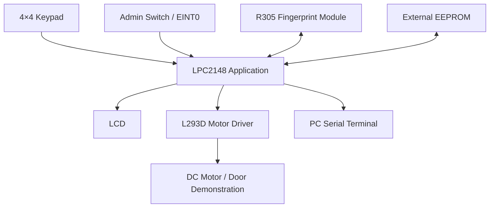
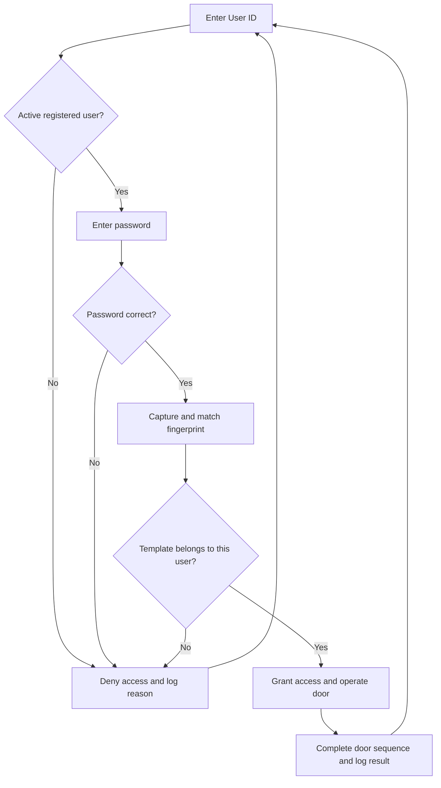
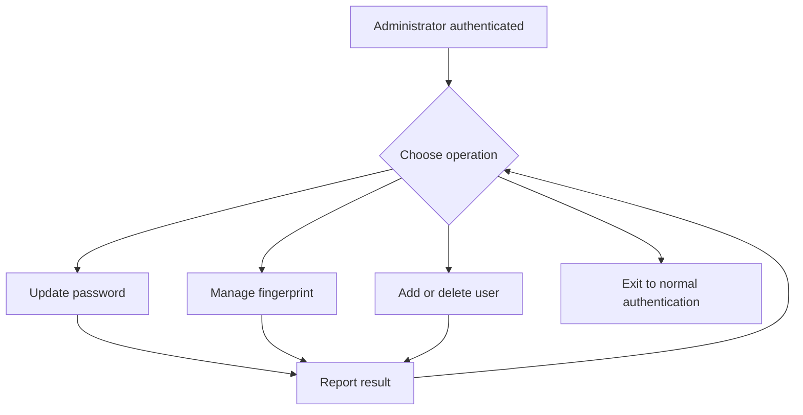
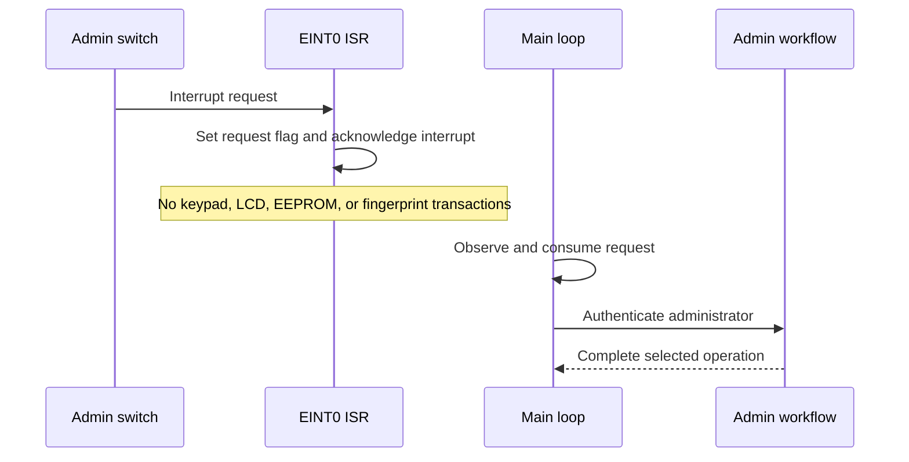
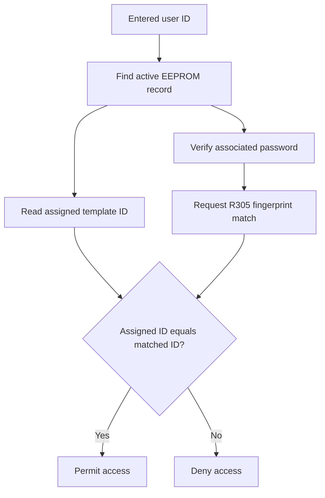

# 🔐 SecureGate Pro

### Intelligent Multi-Level Biometric Access Control and Intrusion Prevention System

**User identification • Password verification • Fingerprint matching • Door control**


An Embedded C access-control project built around the **LPC2148 ARM7 microcontroller**. SecureGate Pro verifies a user ID, password, and fingerprint before granting access. It provides administrator-controlled user management, LCD feedback, UART event logging, and a motor-driven door demonstration.

> This README documents the supplied project abstract. A hardware output photograph is included below. Source code, schematics, pin assignments, and measured test results were not supplied with the abstract. Build settings and hardware connections must be confirmed against the actual implementation.

## 📑 Contents

- [Overview](#-overview)
- [Features](#-features)
- [Hardware components](#-hardware-components)
- [Pin and interface configuration](#-pin-and-interface-configuration)
- [Development environment](#-development-environment)
- [System architecture](#-system-architecture)
- [Authentication workflow](#-authentication-workflow)
- [Administrator functions](#-administrator-functions)
- [Interrupt architecture](#-interrupt-architecture)
- [Data and credential storage](#-data-and-credential-storage)
- [Project structure](#-project-structure)
- [Getting started](#-getting-started)
- [Usage](#-usage)
- [Hardware output](#-hardware-output)
- [Example UART output](#-example-uart-output)
- [Validation checklist](#-validation-checklist)
- [Troubleshooting](#-troubleshooting)
- [Scope and limitations](#-scope-and-limitations)
- [Future improvements](#-future-improvements)

---

## 📌 Overview

The system checks a registered user ID and its associated password, then verifies that the detected fingerprint belongs to the same user. Access is granted only after all checks succeed. An L293D driver controls a DC motor to demonstrate door opening and closing.

A dedicated switch requests the administrator menu through an external interrupt. The interrupt handler sets a flag; the main application handles authentication and menu operations.

**Authentication sequence:** user ID verification → password verification → fingerprint verification → access decision.

A user ID identifies the account; the password and fingerprint provide knowledge and biometric verification. The three checks should not be described as three independent authentication factors.

## ✨ Features

| Feature | Description |
|---|---|
| 🔐 Multi-level verification | Checks user ID, password, and the associated fingerprint before access |
| 👤 User registration | Checks for duplicate IDs and associates each user with a fingerprint template |
| 🔑 Password management | Verifies the existing password and confirms the replacement |
| 👆 Fingerprint management | Enrolls and deletes templates through the R305 module |
| 🗑️ User deletion | Requires confirmation, removes the template, and deactivates the record |
| 🖥️ LCD interface | Displays input prompts and authentication results |
| 📡 UART reporting | Sends access and administrator events to a PC terminal |
| 🚪 Door demonstration | Uses an L293D and DC motor to simulate opening and closing |
| ⚡ Interrupt-driven request | EINT0 sets a flag; administrator work runs in the main loop |
| 🚫 Failed-attempt reporting | Reference logs include account-lock events; firmware must define the exact policy |

## 🔌 Hardware Components

| Component | Purpose |
|---|---|
| LPC2148 development board | Executes the application and peripheral-control firmware |
| R305 fingerprint module | Captures fingerprints and manages fingerprint templates |
| External EEPROM | Stores user records, passwords, and template-ID associations |
| 4×4 keypad | Accepts user IDs, passwords, and menu selections |
| LCD | Displays prompts, results, and system status |
| Push button / switch | Requests the administrator menu through EINT0 |
| L293D motor driver | Drives the door-demonstration motor |
| DC motor | Simulates door opening and closing |
| USB-to-UART converter | Connects compatible serial signals to a PC |
| MAX232, when an RS-232 connection is used | Converts between compatible logic-level UART and RS-232 voltage levels |
| Suitable power supplies and wiring | Power and connect the board and peripherals |

### Hardware Details to Confirm

The abstract names **AT25C256** EEPROM but also lists `i2c.c` and `i2c.h` in the integration steps. Confirm the actual EEPROM part number and its required interface against the component datasheet and schematic before wiring or selecting a driver.

The UART allocation, pin multiplexing, baud rates, LCD configuration, and motor timings must match the firmware. A logic-level USB-UART connection and an RS-232 connection have different electrical requirements; select the appropriate connection path and voltage levels.

## 📍 Pin and Interface Configuration

The abstract identifies functional connections but does not provide a verified pin map. The table below records the required connections without assigning unconfirmed GPIO numbers.

| Peripheral | Logical connection | Configuration to confirm |
|---|---|---|
| Administrator switch | LPC2148 EINT0 | Physical pin, edge/level trigger, pull resistor, debounce |
| R305 module | UART connection | UART channel, TX/RX pins, baud rate, electrical levels |
| PC event log | UART0, as identified in the abstract | TX/RX mapping, frame settings, converter type |
| External EEPROM | Interface matching the actual part | Part number, bus, pins, write timing, addressing |
| LCD | Board-defined control and data signals | GPIO mapping, display size, interface mode |
| 4×4 keypad | Row and column GPIOs | Pin assignments, scan method, key mapping |
| L293D | Direction and enable control | GPIOs, motor supply, enable behavior, run duration |

> Add the final schematic and physical pin numbers after checking the firmware. Do not reuse the exam-hall project's pin map: this project has a different peripheral configuration.

## 🛠️ Development Environment

- Embedded C.
- Keil µVision with an LPC2148-compatible compiler/toolchain and device support.
- Flash Magic for programming through the supported ISP connection.
- A PC serial-terminal application for viewing UART logs.
- R305 vendor testing software, if available, for standalone module checks.

Exact tool versions and compiler settings are not specified in the abstract.

## 🏗️ System Architecture



## ⚙️ Authentication Workflow



1. Initialize the microcontroller and connected peripherals.
2. Prompt for the user ID through the keypad.
3. Find the active user record in EEPROM; deny access if it is not registered.
4. Read the entered password and compare it with the associated credential.
5. Request fingerprint capture and matching through the R305 module.
6. Verify that the matched template ID belongs to the selected user record.
7. Grant access only when every check succeeds.
8. Operate the motor according to the configured door sequence and display the result.
9. Report relevant authentication and door events over UART.

On authentication failure, display a failure message, retain the locked/access-denied state, and return to the appropriate prompt. Lockout thresholds, reset behavior, and unlocking rules must be defined in the implementation.

## 👤 Administrator Functions

The administrator menu is entered only after administrator authentication.

| Menu option | Behavior |
|---|---|
| Edit Password | Verify the current password, request and confirm a new password, then save the update |
| Edit Fingerprint | Enroll or delete a selected fingerprint template |
| Add User | Reject duplicate user IDs, confirm the password, assign an unused template ID, and enroll the fingerprint |
| Delete User | Confirm deletion, delete the associated fingerprint template, and mark the user record inactive |
| Exit | Return to normal authentication |



Complete registration only after the necessary EEPROM and fingerprint operations succeed. Handle partial failures so a user record does not reference an invalid template.

## ⚡ Interrupt Architecture

The abstract specifies a short EINT0 interrupt handler:

1. Set an administrator-menu request flag.
2. Clear the external-interrupt flag as required by the LPC2148 hardware.
3. Complete the required interrupt-controller acknowledgement and return.

The main loop checks the request flag and performs the administrator workflow. LCD updates, keypad input, EEPROM transactions, and fingerprint operations belong outside the ISR.



UART interrupt handling is also included in the project requirements. Buffer sizes, receive processing, and error handling should be documented alongside the actual source implementation.

## 💾 Data and Credential Storage

| Storage location | Information |
|---|---|
| External EEPROM | User ID, associated password, fingerprint-template ID, and record status |
| R305 internal fingerprint library | Fingerprint templates used for matching |
| MCU working memory | Temporary keypad input, communication buffers, and application state |
| PC serial terminal | Received event output; persistent saving depends on terminal configuration |

The user record connects an account to its fingerprint template. Matching any enrolled fingerprint is insufficient: the returned template ID must match the selected account.



The record layout, capacity, password protection, and update-recovery strategy must be documented from the firmware. This abstract does not establish encrypted credential storage.

## 📁 Project Structure

The abstract references these files during integration. This list is a documentation guide, not a verified repository inventory.

| File / module | Responsibility |
|---|---|
| `projectmain.c` | Initialization, authentication flow, and administrator-menu coordination |
| `lcd.c`, `lcd.h` | LCD interface |
| `keypad.c`, `keypad.h` | Keypad scanning and input |
| `delay.c`, `delay.h` | Timing utilities |
| `uart0.c`, `uart0.h` | UART0 communication and event reporting |
| `uart1.c`, `uart1.h` | UART1 communication; confirm its assigned peripheral |
| `eeprom.c`, `eeprom.h` | Persistent user-record access |
| `i2c.c`, `i2c.h` | I²C support referenced by the abstract; confirm the actual connected device |
| Fingerprint module code | R305 command packets, responses, enrollment, and matching |
| Motor-control code | L293D control and door-demonstration sequence |

### Suggested Repository Layout

This is a proposed organization for GitHub, not a claim that these folders already exist. Keep the module filenames aligned with the actual firmware.

| Directory / item | Suggested contents |
|---|---|
| `inc/` | Peripheral and application header files |
| `src/` | Application and peripheral-driver C files |
| `project/` | Keil project, startup files, and required target configuration |
| `docs/` | Abstract, pin map, schematic, and validation notes |
| `docs/images/` | Includes `securegate-hardware-output.jpeg`, referenced by this README |
| `README.md` | Project overview and setup instructions |

### Hardware Demonstration and Screenshots

The supplied hardware photograph is included in the Hardware Output section. Additional useful evidence includes a labelled wiring image, authentication results, UART logs, and a door-control video. No Proteus simulation is claimed.

## 🚀 Getting Started

1. Open the existing Keil project, or create a project targeting the LPC2148.
2. Add the application and required peripheral-driver source files.
3. Configure startup code, memory layout, clock settings, and include paths for the actual board.
4. Verify pin assignments and peripheral settings against the schematic.
5. Build the project and resolve compiler errors and relevant warnings.
6. Enable HEX output if required by the Flash Magic workflow.
7. Connect the supported programming interface and enter ISP mode according to the board instructions.
8. Select the correct device, serial port, oscillator frequency, and programming settings in Flash Magic.
9. Program the generated HEX file and reset the board into normal execution.
10. Open the PC terminal using the UART settings configured in the firmware.

The abstract does not provide a project filename, oscillator value, pin map, or baud rate; use the values from the implemented project rather than guessed defaults.

## ▶️ Usage

### Register a User

1. Press the administrator-menu switch.
2. Authenticate as the administrator.
3. Select **Add User**.
4. Enter a new user ID and confirm its password.
5. Follow the fingerprint-enrollment prompts.
6. Confirm successful registration on the LCD and serial terminal.

### Request Access

1. Enter a registered user ID.
2. Enter the associated password.
3. Present the enrolled finger when prompted.
4. Observe the access decision, motor action, and UART events.

### Delete a User

1. Authenticate in the administrator menu and select **Delete User**.
2. Enter the target user ID.
3. Confirm with `#`, or cancel with `*`, as described in the abstract.
4. Verify the deletion message and that the user can no longer authenticate.

## 📷 Hardware Output


**Figure 1. Actual hardware photograph supplied for this project.** The development board is powered and connected to external modules. The LCD displays `DOOR OPENED` and a prompt to press a switch to close the door.

This photograph documents the displayed door-open state. It does not by itself demonstrate all authentication stages, motor movement, or a complete validation run. The original photo is included without altering the hardware or displayed result.

## 🖥️ Example UART Output

The following is illustrative output adapted from the abstract, not a captured hardware test result:

```text
SYSTEM STARTED
SYSTEM INITIALIZED SUCCESSFULLY
USER 1001 - USER ID VERIFIED
USER 1001 - PASSWORD VERIFIED
USER 1001 - FINGERPRINT VERIFIED
USER 1001 - ACCESS GRANTED
USER 1001 - DOOR OPENED
USER 1001 - DOOR CLOSED
USER 1004 - FINGERPRINT MISMATCH
USER 1004 - ACCESS DENIED
USER 1002 - ACCOUNT LOCKED
USER 1002 - ACCESS DENIED
```

Do not transmit passwords or raw fingerprint data in diagnostic logs. Timestamped logging is suggested as an enhancement in the abstract and is not established as implemented.

## ✅ Validation Checklist

These are suggested acceptance tests, not claimed test results.

| Scenario | Expected behavior |
|---|---|
| Registered ID, correct password, matching fingerprint | Access granted and configured door sequence executed |
| Unknown or inactive user ID | Access denied |
| Incorrect password | Access denied; failure policy applied |
| Valid fingerprint belonging to another user | Access denied |
| Duplicate user registration | Existing-ID message; no duplicate record created |
| Password confirmation mismatch | Existing password retained |
| Cancelled user deletion | User record and template remain unchanged |
| Successful user deletion | Record deactivated and associated template deleted |
| Fingerprint module timeout | Error reported without granting access |
| EEPROM or enrollment failure | Failure reported; no incomplete active registration |
| Power cycle after a successful update | Committed user records remain available |
| Administrator switch event | Request handled by the main loop after ISR completion |
| Long or invalid keypad input | Input rejected or bounded without corrupting memory |

## 🔧 Troubleshooting

| Symptom | Checks |
|---|---|
| Undefined-symbol linker error | Confirm the corresponding `.c` implementation is added to the Keil build and names match the declarations |
| Header not found | Check include paths and the actual location of the header |
| LCD blank or unreadable | Check power, contrast, pin mapping, initialization, and interface mode |
| Keypad returns incorrect keys | Check row/column wiring, scan order, key mapping, and debounce |
| R305 does not respond | Check power, UART settings, TX/RX wiring, packet format, and acknowledgement handling |
| EEPROM data does not persist | Confirm part/interface, address handling, write completion, and record commit logic |
| Serial terminal shows corrupted text | Match baud rate and framing; check clock configuration and electrical interface |
| Motor does not move | Check motor supply, common ground, L293D connections, enable signals, and control outputs |
| Administrator menu does not open | Check EINT0 configuration, interrupt acknowledgement, and main-loop flag handling |
| Wrong user is accepted | Verify that the matched fingerprint-template ID is checked against the selected user record |

## 📋 Scope and Limitations

- The DC motor demonstrates door motion; a production lock mechanism and door-position feedback are outside the supplied abstract.
- The abstract does not establish credential encryption, tamper resistance, secure boot, or a production security certification.
- Account unlock and log-view events appear in sample logs, but corresponding administrator-menu implementations are not specified.
- Maximum user count, record format, lockout policy, recovery behavior, and measured reliability require confirmation from the source code and hardware tests.
- No software license is specified by the abstract. Add a license file only after deciding the repository's licensing terms.

## 💡 Future Improvements

- Define and test timeout, retry, lockout, and administrator-recovery policies.
- Add resilient EEPROM updates and recovery from interrupted registration or deletion.
- Add door-position feedback and explicit open/close fault detection.
- Add timestamps using a confirmed time source.
- Improve credential protection and review the physical security of stored records.
- Document the final schematic, pin map, firmware build settings, and captured test evidence.

## 📤 Adding This Documentation to GitHub

1. Extract the documentation ZIP.
2. Copy `README.md` into your repository root.
3. Copy the entire `docs` folder into the same repository root.
4. Commit and push both items together. The relative image path requires the `docs/images` folder to be present.
5. Open the README on GitHub to view the photo and rendered Mermaid diagrams.

The included block diagram describes functional connections, not exact wiring. This package contains documentation and the supplied output photo; firmware source files are not included.
